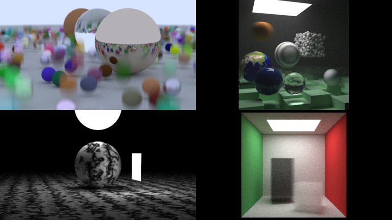

Hellope! Short article this time!

Two months ago, I followed a software ray tracing book series, and I ported all the code to Odin! I added some features too. There's more info in the readme. [Check it out!](https://github.com/lucypero/lucyray)

# Life update

About two months ago, I've been laid off from my game developer job. I've been working there for about two years and I loved the job, so it's been tough. On the upside, I now have more time to code in Odin! I've been working hard on a videogame with my associate. Can't wait to have something to show you. We're making the game _from scratch_, using my own 2D DX12 renderer. Very exciting.

And well, I'm looking for a job now haha :sweat:... So, [email me](mailto:lucyperopero@gmail.com) if you need a passionate and talented software engineer!

I'll be updating this website more frequently, so see you around!
