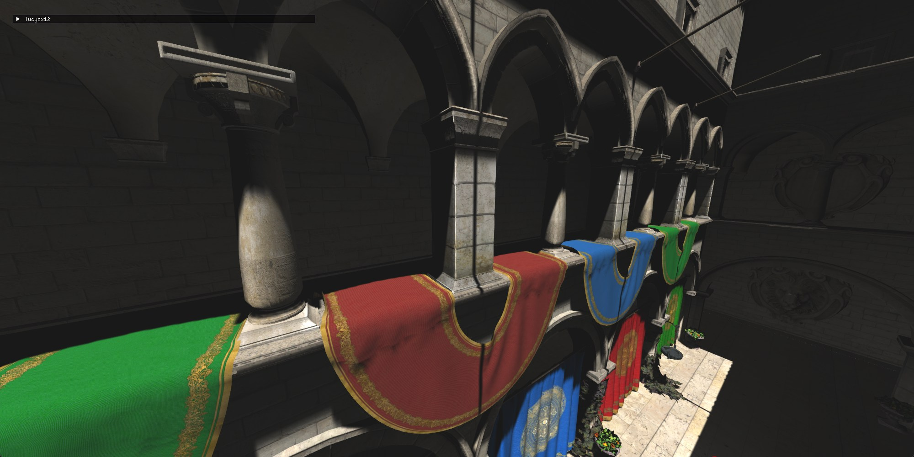
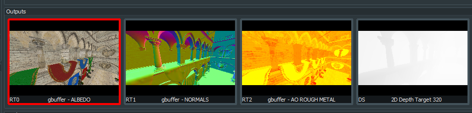

A Direct3D 12 renderer I'm building in [Odin](https://odin-lang.org/) to learn modern graphics programming.

## Features

- **Bindless**: one root signature for every PSO; shaders index resources directly from the descriptor heap.
- **Deferred rendering**: G-buffer pass (albedo, normals, AO + roughness), then a lighting pass.
- **Asset streaming**: a worker thread uploads scenes on the GPU copy queue, so scene switches don't stutter.
- **Shader interop through RTTI**: input layouts and HLSL structs are generated from Odin structs.
- **Shadow maps** with PCF filtering.
- **FXAA** in a compute pass.
- **glTF loading** with a cache of GPU-ready, mipmapped textures.
- **Dear ImGui** for live tweaking.

TODO: what you're working on now / next.

## Gallery

<video controls>
  <source src="../assets/lucydx12/lucydx12_1ydJcmnS2Q.mp4" type="video/mp4">
</video>

_Scene switch while the camera moves; assets stream in without stutter._

<video controls>
  <source src="../assets/lucydx12/lucydx12_4ECcmMXWgj.mp4" type="video/mp4">
</video>

_Shadow maps._

