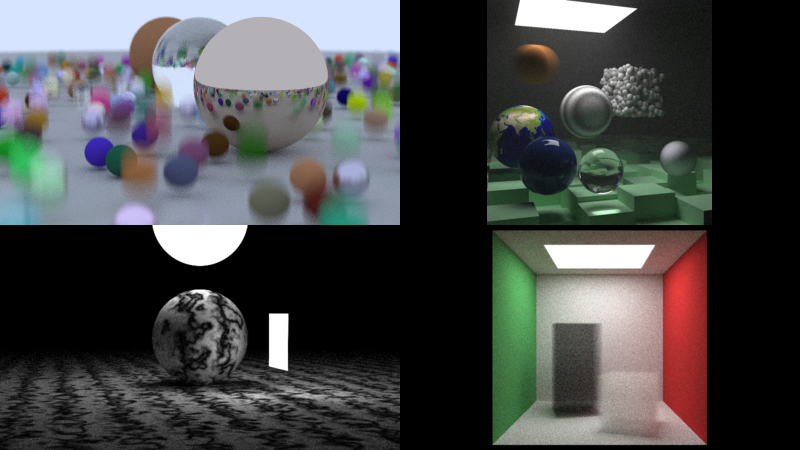

A software ray tracer, written in [Odin](https://odin-lang.org/) by following the [Ray Tracing in One Weekend](https://raytracing.github.io/) book series (books 1 and 2).

## Beyond the books

- **Multithreading**: the image is split into 32x32 tiles; threads claim the next tile through an atomic counter.
- **Fast random number generator.**
- **Monte Carlo sampling** for random points.

TODO: render times / speedup from multithreading, anything you'd do next.
