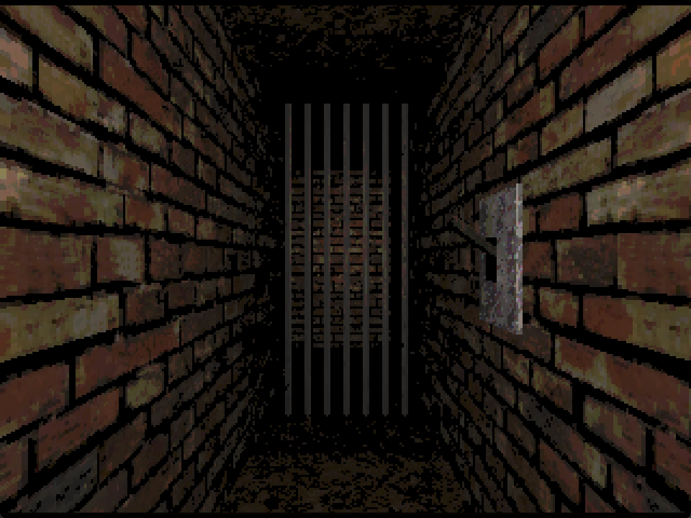
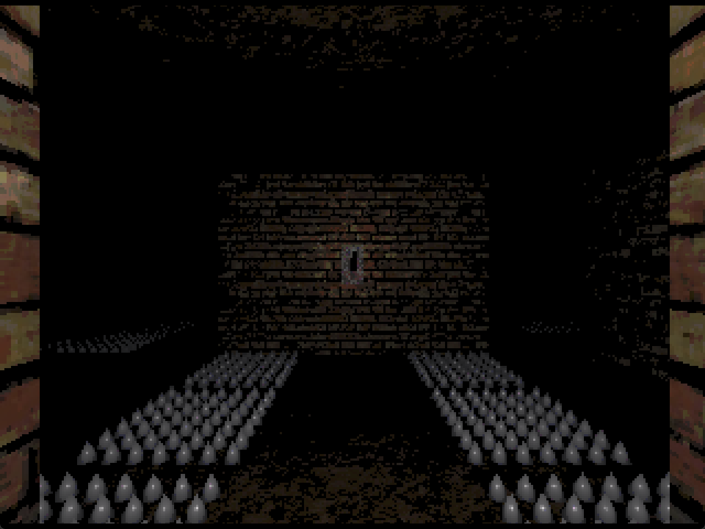
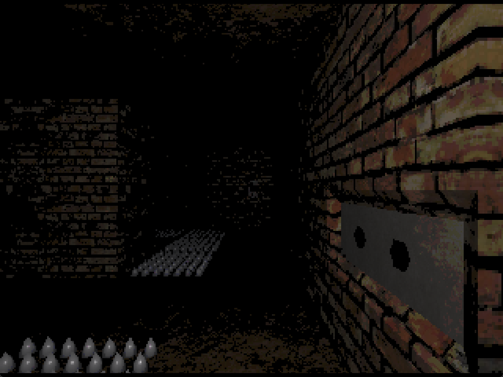

This is a small game made in seven days with my partner, for the [Odin 7 Day Jam](https://itch.io/jam/odin-7-day-jam), where it placed 2nd overall out of 61 entries. The jam's host, Karl Zylinski, [played it on stream](https://www.youtube.com/watch?v=LwCjJoW89Ws&t=5503s).

The game is a scary dungeon crawler where you have to avoid traps, flip levers, and get to the exit before the time runs out!

## Tech

- [Odin](https://odin-lang.org/) and [Raylib](https://www.raylib.com/), starting from Karl Zylinski's Odin + Raylib web template
- [LDtk](https://ldtk.io/) for levels
- [Blender](https://www.blender.org/) for 3D assets
- Music and 3D assets made by the team; sound effects from freesound.org

## Screenshots

