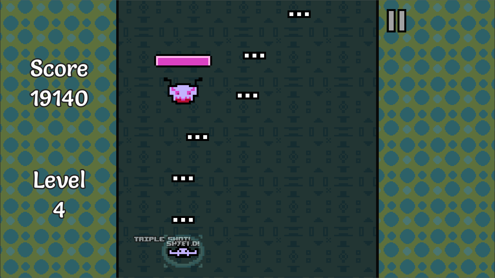

Pew Pew Baba is out on itch.io!

<iframe frameborder="0" src="https://itch.io/embed/2539667?linkback=true&amp;dark=true" width="552" height="167"><a href="https://lucypero.itch.io/pew-pew-baba">Pew Pew Baba by Lucy</a></iframe>

Pew Pew Baba is a fun, small Godot game. It's an endless scroller where you have to dodge enemies and get more powerful to get a high score. Only two buttons are needed to play! A/D, or Left/Right key. Controllers are also supported.

I used [Aseprite](https://www.aseprite.org/) for the pixel art and [Bfxr](https://www.bfxr.net/) for the sound effects. My partner made the awesome music track.

This project made me learn how to do basic things in Godot like custom shaders with properties that I can modify via code, tweening, instancing, UI, and more.

## Technologies used

- [Godot](https://godotengine.org/) (GDScript scripting)
- [Aseprite](https://www.aseprite.org/) for art
- [Bfxr](https://www.bfxr.net/) for sound effects

## Gallery

<iframe width="560" height="315" src="https://www.youtube.com/embed/1ABjfJQ6L5w?si=dGTE0mlccb7zIfXD" title="YouTube video player" frameborder="0" allow="accelerometer; autoplay; clipboard-write; encrypted-media; gyroscope; picture-in-picture; web-share" allowfullscreen></iframe>
